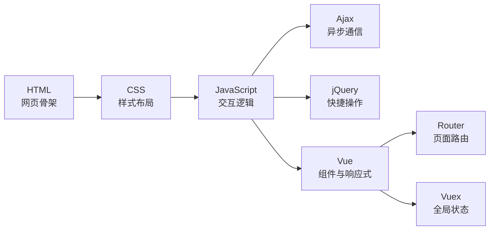
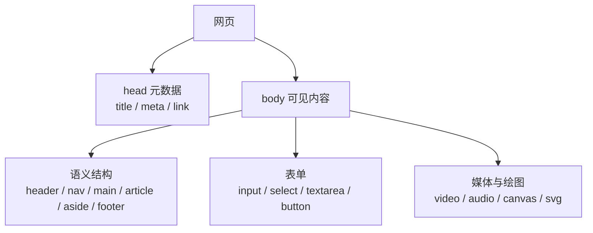
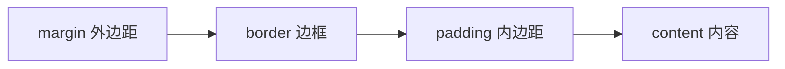
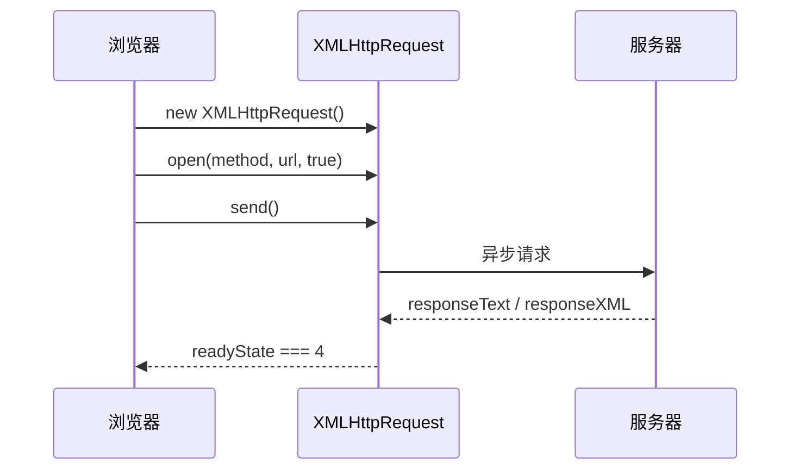
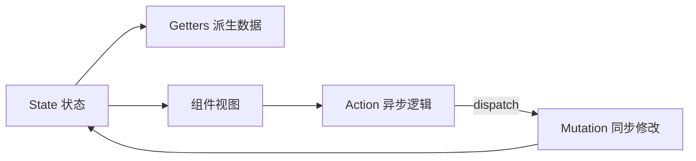

# Web 前端考试知识点速记

> 这份笔记根据当前题库中“Web 前端设计”分类整理，共 248 道题，覆盖 HTML5、CSS3、JavaScript、Ajax、jQuery、Vue、模块化和少量网页设计基础。目标是让你先记住选择题的判断依据，再去刷题。
>
> 题库中的 Vue 题按 Vue 2/Vue Router/Vuex 的常见写法出题。个别题目表述比较简化，考试时优先按题库和教材的标准说法判断。

---

<div style="border:2px solid #5b8def;border-radius:14px;padding:16px;background:#f4f8ff">

### 🎯 这份笔记怎么用

- <mark>🟡 第一遍</mark>：只看带「必背」和「易错」的句子。
- <mark>🟢 第二遍</mark>：遮住右侧答案，只看关键词回忆。
- <mark>🔴 第三遍</mark>：马上回题库刷对应分类，错题只记一句话。

**颜色说明：** 🟢 正确概念　🔴 错误说法　🟡 容易混淆　🔵 记忆口诀

</div>

### 🗺️ 前端知识地图



> <mark>🔵 口诀：HTML 搭骨架，CSS 穿衣服，JS 做动作，Ajax 找后端，Vue 管组件。</mark>

---

## 一、先记住前端各部分是做什么的

| 技术 | 主要职责 | 选择题关键词 |
|---|---|---|
| HTML | 定义网页的结构和内容 | 标签、语义、表单、媒体 |
| CSS | 控制网页的样式和布局 | 颜色、字体、盒模型、Flex、动画 |
| JavaScript | 编写交互和业务逻辑 | 变量、事件、DOM、异步 |
| Ajax | 页面不刷新地和服务器通信 | XMLHttpRequest、JSON、异步 |
| jQuery | 简化 DOM、事件、动画操作的 JavaScript 库 | `$`、选择器、`on`、`css` |
| Vue | 组件化、响应式的前端框架 | 指令、实例、生命周期、路由 |
| Vue Router | 管理前端页面路由 | `router-link`、`router-view`、`path` |
| Vuex | 管理多个组件共享的全局状态 | State、Getters、Mutations、Actions |
| Node.js / npm | 前端工程运行环境和包管理 | npm install、LTS、依赖 |

做题时先判断题目在问哪一层：**结构是 HTML，样式是 CSS，行为是 JavaScript，页面通信是 Ajax，组件状态是 Vue/Vuex。**

---

## 二、HTML5 与网页结构

<div style="border-left:5px solid #f0ad4e;padding:10px 14px;background:#fff9ed">

**🟡 HTML 一眼判断：** 题目问“结构、标签、表单、媒体、语义”，优先在 HTML5 中找答案；题目问“颜色、间距、布局、动画”，切到 CSS。

</div>



### 1. HTML 基础

HTML 是一种**标记语言**，不是编程语言。W3C 是常见的标准制定组织。

最基本结构：

```html
<!DOCTYPE html>
<html>
<head>
  <meta charset="UTF-8">
  <title>网页标题</title>
  <link rel="stylesheet" href="style.css">
</head>
<body>
  网页可见内容
</body>
</html>
```

必记：

- `<!DOCTYPE html>`：声明 HTML5 文档类型。
- `<html>`：根元素。
- `<head>`：放元数据，通常不直接显示在页面主体中。
- `<body>`：放网页可见内容。
- `<title>`：浏览器标签页/窗口标题。
- `<meta charset="UTF-8">`：指定字符编码。
- `<link>`：常用于引入外部 CSS。
- `<script>`：引入或编写 JavaScript。

易错：

- `<head>` 不是显示网页主要内容的地方。
- `<title>` 不是网页正文标题；正文标题通常使用 `<h1>`。
- HTML5 是标记语言，不是“新的编程语言”。

### 2. 常用标签

| 目的 | 标签 |
|---|---|
| 段落 | `<p>` |
| 无序列表 | `<ul>` + `<li>` |
| 有序列表 | `<ol>` + `<li>` |
| 链接 | `<a href="...">` |
| 图片 | `` |
| 容器 | `<div>` |
| 行内容器 | `<span>` |
| 表格 | `<table>`、`<tr>`、`<th>`、`<td>` |
| 表单 | `<form>` |
| 输入框 | `<input>` |
| 多行文本 | `<textarea>` |
| 下拉框 | `<select>` + `<option>` |
| 按钮 | `<button>` |

易错：

- `<div>` 是通用块级容器，不是链接。
- `<button>` 是按钮，不是复选框。
- 复选框使用 `<input type="checkbox">`。
- 文本输入框常用 `<input type="text">`。
- 输入框默认值使用 `value` 属性。
- 输入框最大长度使用 `maxlength` 属性。

### 3. HTML5 语义元素

语义元素通过标签名称表达内容含义，利于结构、可读性和搜索引擎理解。

| 标签 | 含义 |
|---|---|
| `<header>` | 页头或区域头部 |
| `<nav>` | 导航 |
| `<main>` | 页面主要内容 |
| `<article>` | 一篇独立文章、帖子或内容单元 |
| `<section>` | 一个主题内容区块 |
| `<aside>` | 主要内容之外的内容，如侧栏、广告 |
| `<footer>` | 页脚或区域底部 |
| `<strong>` | 表示重要、强调的文本 |

高频判断：

- `<aside>` 可以表示侧边栏或广告：对。
- `<article>` 表示文章主要内容：对。
- `<header>`、`<article>`、`<section>` 都是语义元素。
- 语义标签不是为了改变样式，样式仍由 CSS 控制。

### 4. HTML5 表单和新输入类型

常见输入类型：

| 写法 | 用途 |
|---|---|
| `text` | 普通文本 |
| `password` | 密码 |
| `email` | 邮箱 |
| `tel` | 电话号码 |
| `number` | 数字 |
| `date` | 日期 |
| `time` | 时间 |
| `color` | 颜色 |
| `range` | 范围滑块 |
| `url` | URL 地址 |
| `search` | 搜索框 |

记忆：

- 电话：`tel`
- 日期：`date`
- 颜色：`color`
- 邮箱：`email`
- 密码：`password`

### 5. 多媒体和绘图

| 目的 | 标签/属性 |
|---|---|
| 视频 | `<video>` |
| 音频 | `<audio>` |
| 媒体来源 | `<source>` |
| 二维绘图 | `<canvas>` |
| 矢量绘图 | `<svg>` |
| 媒体地址 | `src` |

易错：

- `canvas` 和 `svg` 是绘图元素。
- 题库将 `canvas` 作为二维绘图标签；不要把它直接理解成原生 3D 绘图方案。
- `iframe` 主要用于嵌入其他网页或文档，不等同于专门的音视频标签。
- `<video>`、`<audio>`、`<source>` 属于多媒体相关元素。

### 6. localStorage 和 sessionStorage

HTML5 常见的两种浏览器本地存储：

- `localStorage`
- `sessionStorage`

区别：

| 项目 | localStorage | sessionStorage |
|---|---|---|
| 生命周期 | 长期保存，除非主动清除 | 当前页面会话结束后清除 |
| 作用范围 | 同源页面共享 | 当前标签页/会话 |
| 容量 | 通常比 sessionStorage 更大 | 通常较小 |
| 数据类型 | 以字符串存储 | 以字符串存储 |

常用代码：

```js
localStorage.setItem('name', '张三');
const name = localStorage.getItem('name');
localStorage.removeItem('name');
localStorage.clear();
```

对象要先转 JSON：

```js
localStorage.setItem('user', JSON.stringify({ id: 1 }));
const user = JSON.parse(localStorage.getItem('user'));
```

必背：

- `localStorage` 存储的数据类型按字符串处理。
- 存对象时使用 `JSON.stringify()`。
- 取对象时使用 `JSON.parse()`。
- `localStorage` 一般比 `sessionStorage` 保存得更久。

### 7. HTML5 拖放

常见属性和事件：

| 名称 | 作用 |
|---|---|
| `draggable="true"` | 允许元素被拖动 |
| `dragstart` | 开始拖动时触发 |
| `dragenter` | 进入放置目标时触发 |
| `dragover` | 在放置目标上方移动时触发 |
| `drop` | 放置时触发 |
| `dataTransfer` | 保存拖放数据 |

典型流程：

1. 被拖元素设置 `draggable`。
2. 在 `dragstart` 中通过 `dataTransfer.setData()` 写入数据。
3. 目标区域通常在 `dragover` 中调用 `preventDefault()`，允许放置。
4. 在 `drop` 中通过 `dataTransfer.getData()` 取出数据。

---

## 三、CSS3 与页面布局

<div style="border-left:5px solid #6f42c1;padding:10px 14px;background:#faf5ff">

**🔵 CSS 口诀：** 选择器找谁，盒模型算大小，Flex 排位置，动画改状态。

</div>

### 1. CSS 选择器

CSS 选择器决定“哪些元素使用这条样式”。

| 写法 | 选择对象 |
|---|---|
| `p` | 所有 `<p>` |
| `.box` | class 为 box 的元素 |
| `#app` | id 为 app 的元素 |
| `*` | 所有元素，通用选择器 |
| `div.box` | 同时满足标签和 class |
| `[type="text"]` | 属性值等于 text |
| `[href^="https"]` | 属性值以 https 开头 |
| `A + B` | A 后面紧邻的 B |
| `A ~ B` | A 后面的所有同级 B |
| `:hover` | 鼠标悬停状态 |
| `:focus` | 获得焦点状态 |
| `:first-child` | 父元素的第一个子元素 |
| `:empty` | 没有子元素的元素 |
| `::before` | 伪元素，不是第一个子元素 |

属性选择器：

- `[attr=value]`：属性值等于 value。
- `[attr^=value]`：属性值以 value 开头。
- `[attr$=value]`：属性值以 value 结尾。
- `[attr*=value]`：属性值包含 value。

兄弟选择器：

- `+`：相邻兄弟，只选紧挨着的下一个。
- `~`：通用兄弟，选择后面所有同级兄弟。

易错：

- `::before` 是伪元素，不是“第一个子元素”。
- `~` 不只选择相邻兄弟。
- `:hover` 是状态伪类。
- `:focus` 常用于输入框获得焦点。
- `* ` 才是选择所有元素的通用选择器。

### 2. 盒模型

#### 🎨 盒模型图



<mark>必背：</mark> `content-box` 只算 content；`border-box` 把 padding 和 border 算进宽高。

一个元素的盒模型从内到外：

```
content（内容）
padding（内边距）
border（边框）
margin（外边距）
```

常见属性：

- `width`、`height`：宽高。
- `padding`：内边距，内容和边框之间。
- `border`：边框。
- `margin`：外边距，元素和其他元素之间。
- `box-sizing`：盒模型计算方式。

```css
.box {
  width: 300px;
  padding: 20px;
  border: 1px solid #ccc;
  margin: 10px;
  box-sizing: border-box;
}
```

两种盒模型：

- `content-box`：默认值，`width/height` 只包括 content。
- `border-box`：`width/height` 包括 content、padding 和 border。

高频判断：

- 盒模型包括内容、内边距、边框、外边距：对。
- `padding` 设置内边距：对。
- `border-box` 让宽高包括内边距和边框：对。
- `margin` 不属于元素内部尺寸。

### 3. 文本样式

| 属性 | 作用 |
|---|---|
| `color` | 文本颜色 |
| `font-size` | 字体大小 |
| `font-family` | 字体 |
| `font-weight` | 粗细 |
| `text-align` | 水平对齐 |
| `line-height` | 行高 |
| `text-decoration` | 下划线、删除线等 |
| `text-transform` | 大小写转换 |

```css
.title {
  color: #333;
  font-size: 20px;
  text-align: center;
  line-height: 1.8;
  text-decoration: none;
  text-transform: uppercase;
}
```

`text-transform: uppercase`：转换为大写。

### 4. Flex 弹性盒布局

创建 Flex 容器：

```css
.container {
  display: flex;
}
```

容器常考属性：

| 属性 | 作用 |
|---|---|
| `flex-direction` | 主轴方向 |
| `justify-content` | 主轴对齐 |
| `align-items` | 交叉轴对齐 |
| `flex-wrap` | 是否换行 |
| `align-content` | 多行整体对齐 |

项目常考属性：

| 属性 | 作用 |
|---|---|
| `order` | 排列顺序 |
| `flex-grow` | 放大比例 |
| `flex-shrink` | 缩小比例 |
| `flex-basis` | 初始尺寸 |
| `align-self` | 单个项目的交叉轴对齐 |

高频判断：

- `display: flex` 定义弹性盒容器。
- `flex-direction` 设置主轴方向。
- `flex-grow: 0` 表示项目不会分配额外空间进行放大。
- `order` 可以改变项目顺序。
- `align-self` 可以单独调整某个项目。
- Flexbox 常用于一维布局、水平/垂直排列和居中。

### 5. 渐变

CSS3 常见渐变：

- 线性渐变：`linear-gradient()`
- 径向渐变：`radial-gradient()`
- 圆锥渐变：`conic-gradient()`

渐变通过颜色停止点控制颜色变化：

```css
.box {
  background: linear-gradient(to right, #fff, #66a);
}
```

题库重点：

- 线性渐变和径向渐变是基础类型。
- 圆心默认值常记为 `center`。
- 颜色停止点决定不同位置的颜色。

### 6. CSS3 动画和过渡

关键帧：

```css
@keyframes fade {
  0%   { opacity: 0; }
  100% { opacity: 1; }
}

.box {
  animation: fade 1s ease-in-out;
}
```

必记：

- `@keyframes` 定义动画关键帧。
- 百分比表示动画时间点。
- `animation` 把关键帧应用到元素。
- `animation-iteration-count` 设置播放次数，`infinite` 表示无限循环。
- `animation-fill-mode` 设置动画前后元素采用的样式状态。
- `transition` 用于属性变化的平滑过渡，不是用来定义页面布局。

### 7. 响应式设计

响应式设计：根据屏幕尺寸、设备特征调整布局和渲染方式。

常见手段：

- 媒体查询：`@media`
- 弹性布局：Flexbox
- 百分比、`rem`、`vw`、`vh`
- 可伸缩图片和网格布局

题库中的判断通常把“根据屏幕大小选择不同渲染方式”判为正确。

---

## 四、JavaScript、模块化和 npm

### 1. 模块化

模块化就是把代码拆成**可复用、独立、可维护的单元**。

优点：

- 降低耦合。
- 封装内部实现。
- 避免全局变量污染。
- 便于复用、维护、测试。
- 便于依赖管理和版本控制。

### 2. CommonJS、AMD、CMD、ES6

| 规范 | 重点 |
|---|---|
| CommonJS | 常见于 Node.js；同步加载；`require` / `module.exports` |
| AMD | 异步模块定义；通常提前声明依赖 |
| CMD | 通常按需、就近加载依赖 |
| ES6 Module | `import` / `export`；每个模块有独立作用域 |

CommonJS：

```js
// 导出
module.exports = { add };

// 导入
const utils = require('./utils');
```

ES6：

```js
// 默认导出
export default App;

// 命名导出
export { add };

// 导入
import App from './App.js';
import { add } from './utils.js';
```

高频判断：

- CommonJS 主要用于 Node.js 环境。
- AMD、CMD 属于 JavaScript 模块化规范。
- CommonJS 不是通过“module 对象同时完成导入和导出”；导入常用 `require`。
- ES6 模块有独立作用域。
- 题库把“IIFE 就是模块化编程的标准实现”判为错误；IIFE 可以隔离作用域，但不要和 ES6 模块混为一谈。

### 3. Node.js 和 npm

- Node.js：JavaScript 的运行环境。
- npm：Node Package Manager，包管理工具。
- 安装 Node.js 后通常会同时安装 npm。
- `npm install`：安装依赖。
- `npm install vue`：安装指定包。
- `node -v`：查看 Node.js 版本。
- `npm -v`：查看 npm 版本。
- 官方安装包优先选择 LTS（长期支持）版本。

---

## 五、Ajax 与异步交互

<div style="border-left:5px solid #20a464;padding:10px 14px;background:#f0fff7">

**🟢 Ajax 成功路线：** 创建对象 → `open` 配置 → `send` 发送 → `readyState === 4` → 检查 `status` → 解析响应。

</div>



### 1. Ajax 是什么

Ajax 全称：

**Asynchronous JavaScript and XML**

它不是一种新的编程语言，而是一种网页开发技术/通信方式，允许网页在不整体刷新的情况下与服务器异步通信。

Ajax 依赖多种技术：

- JavaScript
- HTML
- CSS
- DOM
- XMLHttpRequest
- JSON/XML

核心特点：**异步请求，局部更新页面。**

### 2. XMLHttpRequest 基本流程

```js
const xhr = new XMLHttpRequest();

xhr.onreadystatechange = function () {
  if (xhr.readyState === 4 && xhr.status === 200) {
    const data = JSON.parse(xhr.responseText);
    console.log(data);
  }
};

xhr.open('GET', '/api/users', true);
xhr.send();
```

流程记忆：

1. 创建 `XMLHttpRequest` 对象。
2. 设置状态变化回调。
3. 使用 `open()` 设置请求方法、URL 和是否异步。
4. 使用 `send()` 发送请求。
5. 检查状态并处理响应。

### 3. readyState 五个值

| 值 | 含义 |
|---|---|
| 0 | 未初始化，尚未调用 `open()` |
| 1 | 已打开，已调用 `open()` |
| 2 | 请求已发送，已收到响应头 |
| 3 | 请求处理中，正在接收响应 |
| 4 | 请求已完成，响应已准备好 |

题库高频陷阱：

- readyState 没有 5。
- 值为 3 不是“请求完成”，而是处理中。
- 请求完成通常检查 `readyState === 4`。
- 还要结合 `status === 200` 等 HTTP 状态码判断成功。

### 4. 响应数据

| 属性/方法 | 作用 |
|---|---|
| `responseText` | 获取文本响应 |
| `responseXML` | 获取 XML 文档对象 |
| `JSON.parse()` | JSON 字符串转 JavaScript 对象 |
| `JSON.stringify()` | JavaScript 对象转 JSON 字符串 |

题库中也会出现：

- `parseJSON()`：用于解析 JSON 的题目选项。
- `getJSON()`：jQuery 加载 JSON。
- `load()`：jQuery 中加载 XML/HTML 等资源的常见方法。

JSON：

```js
const text = '{"name":"张三"}';
const obj = JSON.parse(text);

const json = JSON.stringify({ name: '张三' });
```

XML 重点：

- XML 文档必须有一个根元素。
- `responseXML` 返回 XML 文档对象。
- 可以通过 DOM 方法访问 XML 节点。

### 5. GET、POST 和 Content-Type

jQuery 常见请求：

```js
$.ajax({ url: '/api', method: 'GET' });
$.get('/api');
$.post('/api', data);
```

题库常考：

- `$.ajax()`、`$.get()`、`$.post()` 都可向服务器发送请求。
- POST 表单编码常见：`application/x-www-form-urlencoded`。
- `404` 表示请求资源未找到。

### 6. 跨域、CORS、JSONP

浏览器有同源策略，协议、域名、端口不同就可能构成跨域。

CORS：

- 全称 Cross-Origin Resource Sharing。
- 常见响应头：`Access-Control-Allow-Origin`。
- 是服务器配合浏览器实现跨域的标准方案。

JSONP：

- 利用 `<script>` 标签可以跨域加载脚本的特性。
- 不是基于 XMLHttpRequest。
- 只适合 GET，不能当作通用的 POST 跨域方案。

高频判断：

- 跨域请求通常受同源策略限制：对。
- CORS 是跨源资源共享规范：对。
- JSONP 基于 XMLHttpRequest：错。
- JSONP 的原理是利用 `script` 标签跨域：对。

---

## 六、jQuery 高频 API

jQuery 是一个**JavaScript 库**，不是后端语言。核心形式：

```js
$(selector).method();
```

### 1. 选择器

| 写法 | 作用 |
|---|---|
| `$('p')` | 所有 p |
| `$('.box')` | class 为 box |
| `$('div.box')` | div 且 class 为 box |
| `$('#app')` | id 为 app |
| `$('[type=text]')` | 指定属性 |
| `$('p:first-child')` | 第一个子元素 |

### 2. DOM、内容、属性、样式

| 目的 | 方法 |
|---|---|
| 读取/设置文本 | `text()` |
| 读取/设置 HTML | `html()` |
| 读取/设置属性 | `attr()` |
| 添加 class | `addClass()` |
| 删除 class | `removeClass()` |
| 切换 class | `toggleClass()` |
| 设置样式 | `css()` |
| 清空内容 | `empty()` |
| 删除元素 | `remove()` |
| 删除但保留数据/事件 | `detach()` |
| 替换元素 | `replaceWith()` |
| 创建元素 | `$(' <div> </div>')` |
| 内部追加 | `append()` |
| 前面插入 | `before()` |
| 包裹元素 | `wrap()` |
| 复制元素 | `clone()` |

注意：

- `html()` 操作 HTML 内容。
- `text()` 操作纯文本。
- `attr()` 操作属性。
- `deleteAttr()` 不是 jQuery 标准方法。
- `clone()` 可以复制元素及其子节点；题库将带事件复制判断为正确。

### 3. 可见性、尺寸

| 目的 | 方法/写法 |
|---|---|
| 隐藏 | `hide()` |
| 显示 | `show()` |
| 切换显示 | `toggle()` |
| 获取/设置宽度 | `width()` |
| 获取/设置高度 | `height()` |
| 外部高度 | `outerHeight()` |
| CSS 隐藏 | `.css('display', 'none')` |
| CSS 不可见 | `.css('visibility', 'hidden')` |

题库中会出现拼写干扰项：

- 正确方法是 `toggle()`，不是 `toogle()`。
- 正确方法是 `removeAttr()`，不是 `deleteAttr()`。

### 4. 事件和事件冒泡

常见事件：

- `click()`
- `mouseenter()`
- `mouseleave()`
- `focus()`
- `blur()`
- `change()`
- `submit()`
- `ready()`
- `load()`

绑定和解绑：

```js
$('button').on('click', handler);
$('button').off('click', handler);
```

题库也会考旧写法：

- `bind()`：绑定事件。
- `unbind()`：解绑旧式事件。
- `off()`：解绑事件。

事件委托：

- `on()`
- `live()`
- `delegate()`

事件冒泡：

- 事件通常从触发事件的元素向父元素逐层传播。
- `event.stopPropagation()`：阻止冒泡。
- `event.preventDefault()`：阻止默认行为，二者不要混淆。
- `on()` 可用于事件绑定和委托。

文档加载：

```js
$(document).ready(function () {
  // DOM 加载完成后执行
});
```

### 5. 动画

常见动画：

- `show()`、`hide()`、`toggle()`
- `fadeIn()`、`fadeOut()`
- `slideDown()`、`slideUp()`
- `animate()`

```js
$('div').fadeIn(600);
$('div').animate({ opacity: 1 }, 600);
```

其他：

- `clearQueue()`：清空动画队列。
- `promise()`：处理动画队列完成。
- `stop()`：停止动画。
- `animate()` 可以创建自定义动画。

---

## 七、Vue 基础

<div style="border-left:5px solid #42b883;padding:10px 14px;background:#f0fff8">

**🟢 Vue 核心：** 数据变了，视图跟着变；组件不要直接改 Vuex 的 State。

</div>



### 1. Vue 的定位

Vue.js 是用于前端开发的渐进式 JavaScript 框架。

特点：

- 轻量级。
- 组件化。
- 响应式。
- 支持双向数据绑定。
- 适合单页面应用和复杂交互页面。
- 核心库主要关注视图层，可逐步集成到现有项目。

题库常考：

- Vue 首个版本：2014 年。
- 创建者：Evan You。
- Vue 不是后端框架。
- Vuex 管理全局状态。
- Vue Router 管理前端路由。

### 2. 创建 Vue 实例

Vue 2 常见写法：

```js
const app = new Vue({
  el: '#app',
  data: {
    message: 'Hello Vue'
  },
  methods: {
    sayHi() {}
  },
  computed: {
    reversed() {}
  },
  watch: {
    message(newValue, oldValue) {}
  }
});
```

实例选项：

| 选项 | 作用 |
|---|---|
| `el` | 指定挂载元素 |
| `data` | 初始数据 |
| `methods` | 定义方法 |
| `computed` | 定义计算属性 |
| `watch` | 监听数据变化 |
| `directives` | 自定义指令 |
| `render` | 渲染函数 |
| `$refs` | 访问引用的 DOM/组件 |

### 3. 生命周期

常见顺序：

```
beforeCreate
created
beforeMount
mounted
beforeUpdate
updated
beforeDestroy
destroyed
```

记忆：

- `beforeCreate`：实例刚开始创建。
- `created`：数据观测和事件初始化完成后调用。
- `mounted`：实例挂载到 DOM 后调用。
- `beforeUpdate`：数据变化、DOM 更新前。
- `updated`：DOM 更新后。
- `beforeDestroy`：销毁前。
- `destroyed`：销毁后。

题库易错点：

- `beforeDestroy` 确实是在组件销毁前调用。
- “数据观测和事件初始化之后”对应 `created`；题库某些单选的选项表述可能不严谨，做题时结合完整选项判断。
- `updated` 不是初始化阶段。

### 4. 常见指令

| 指令 | 作用 |
|---|---|
| `v-bind` | 单向绑定属性 |
| `:src` | `v-bind:src` 的缩写 |
| `v-model` | 表单双向数据绑定 |
| `v-on` | 绑定事件 |
| `@click` | `v-on:click` 的缩写 |
| `v-if` | 条件渲染，添加/移除 DOM |
| `v-show` | 条件显示，控制 CSS display |
| `v-for` | 列表渲染 |
| `v-text` | 设置文本 |
| `v-html` | 设置 HTML |
| `v-pre` | 跳过该元素及子元素的编译 |

```html
<input v-model="name">
<p>{{ name }}</p>
<button @click="submit">提交</button>

<div v-if="visible">条件成立才创建</div>
<div v-show="visible">始终存在，只切换显示</div>
```

重点区别：

- `v-bind`：数据到视图，单向。
- `v-model`：表单输入和数据之间双向。
- `v-if`：条件不满足时移除 DOM。
- `v-show`：元素仍在 DOM 中，只改变 `display`。
- `v-pre`：跳过编译。

### 5. computed、watch、methods

| 选项 | 适合场景 |
|---|---|
| `computed` | 根据已有响应式数据计算出新值；有缓存 |
| `watch` | 监听数据变化并执行副作用、异步操作 |
| `methods` | 定义普通方法，调用才执行 |

计算属性：

- 依赖不变时有缓存，不会重复计算。
- 适合模板中频繁使用的复杂表达式。
- 适合根据多个响应式数据计算一个值。

监听器：

- 监听某个数据的变化。
- 适合请求接口、执行异步操作、复杂副作用。

### 6. 表单

- `v-model` 是双向绑定的常见方式。
- `v-bind` 只能做单向绑定。
- 自定义组件通常通过 props 和 emit 配合实现双向通信。
- 常见校验：必填、最小长度、最大长度、数字格式。
- `maxlength` 设置最大长度。
- 输入框值变化常用 `input` 事件。

### 7. Vue Router

安装：

```bash
npm install vue-router
```

核心组件：

- `<router-link>`：导航链接。
- `<router-view>`：显示匹配的组件。

常见配置：

```js
const routes = [
  { path: '/', component: Home },
  { path: '/user/:id', component: User }
];
```

必记：

- 路由关键字是 `path`。
- 动态参数写成 `/user/:id`。
- 在父路由的 `children` 中定义嵌套路由。
- 子路由组件在父组件的 `<router-view>` 中渲染。
- 当前路由信息常通过 `this.$route` 访问。
- 路由实例注入 Vue 根实例的 `router` 选项。
- `router-link` 用于跳转；普通 `<a href>` 也能跳转 URL，但不等于 Vue Router 的组件导航。

### 8. Vuex

安装：

```bash
npm install vuex
```

四个核心概念：

| 概念 | 作用 | 记忆词 |
|---|---|---|
| State | 全局状态 | 数据 |
| Getters | 从 State 派生计算值 | 查询/计算 |
| Mutations | 同步修改 State | commit |
| Actions | 异步逻辑，提交 Mutation | dispatch |

数据流：

```
组件 dispatch Action
        ↓
Action 处理异步逻辑
        ↓
commit Mutation
        ↓
Mutation 同步修改 State
        ↓
组件响应式更新
```

常见调用：

```js
this.$store.state.user
this.$store.getters.total
this.$store.commit('increment')
this.$store.dispatch('loadData')
```

高频判断：

- Mutation 主要用于同步修改 State。
- Action 主要用于异步操作，不能直接修改 State。
- 组件不应该直接修改 State。
- Getters 可以从 State 派生新的状态或计算属性。
- Vuex 适合管理多个组件共享的全局状态。
- 查看当前状态常看调试工具的 State 面板。

---

## 八、选择题快速排除法

<div style="border:2px solid #e55353;border-radius:12px;padding:14px;background:#fff5f5">

### 🚨 考场红线

1. `readyState` 只有 **0、1、2、3、4**，没有 5。
2. `stopPropagation()` 管冒泡，`preventDefault()` 管默认行为。
3. `v-bind` 是单向绑定，`v-model` 是表单双向绑定。
4. `v-if` 会创建/移除 DOM，`v-show` 只切换 `display`。
5. Mutation 同步改 State，Action 负责异步并提交 Mutation。
6. JSONP 借助 `script` 跨域，不是 XMLHttpRequest。

</div>

看到下面关键词，优先联想到对应答案：

| 题干关键词 | 优先记忆 |
|---|---|
| 浏览器标题 | `title` |
| 字符编码 | `meta charset` |
| 语义文章 | `article` |
| 侧边栏 | `aside` |
| 电话输入 | `tel` |
| 日期输入 | `date` |
| 绘图 | `canvas` / `svg` |
| 客户端长期存储 | `localStorage` |
| 拖放数据 | `dataTransfer` |
| 所有元素 | `*` |
| 属性值等于 | `[attr=value]` |
| 属性值开头 | `[attr^=value]` |
| 相邻兄弟 | `+` |
| 所有后续兄弟 | `~` |
| 内边距 | `padding` |
| 包含边框的盒模型 | `border-box` |
| 弹性容器 | `display: flex` |
| 主轴方向 | `flex-direction` |
| 动画关键帧 | `@keyframes` |
| 线性渐变 | `linear-gradient()` |
| 异步请求 | Ajax |
| 请求状态 | `readyState` |
| 文本响应 | `responseText` |
| XML 响应 | `responseXML` |
| 请求完成 | `readyState === 4` |
| 跨域响应头 | `Access-Control-Allow-Origin` |
| JSONP 原理 | `script` 跨域 |
| jQuery 绑定 | `on()` |
| jQuery 解绑 | `off()` |
| 阻止冒泡 | `stopPropagation()` |
| 阻止默认行为 | `preventDefault()` |
| 设置 HTML | `html()` |
| 设置文本 | `text()` |
| 设置属性 | `attr()` |
| 添加 class | `addClass()` |
| Vue 挂载 | `el` |
| Vue 初始数据 | `data` |
| Vue 方法 | `methods` |
| Vue 计算值 | `computed` |
| Vue 监听变化 | `watch` |
| Vue 双向绑定 | `v-model` |
| Vue 单向属性绑定 | `v-bind` |
| Vue 路由导航 | `router-link` |
| Vue 路由出口 | `router-view` |
| Vuex 同步修改 | Mutation / `commit` |
| Vuex 异步逻辑 | Action / `dispatch` |

---

## 九、最容易混淆的成对概念

### 1. padding 和 margin

- padding：元素内部，内容和边框之间。
- margin：元素外部，元素和其他元素之间。

### 2. border-box 和 content-box

- content-box：宽高只算内容。
- border-box：宽高包含 padding 和 border。

### 3. v-bind 和 v-model

- v-bind：单向，数据 → 属性。
- v-model：表单双向，数据 ↔ 输入值。

### 4. v-if 和 v-show

- v-if：添加/移除 DOM。
- v-show：保留 DOM，切换 display。

### 5. computed 和 watch

- computed：计算一个值，有缓存。
- watch：监听变化，执行副作用。

### 6. Mutation 和 Action

- Mutation：同步修改 State。
- Action：异步逻辑，提交 Mutation。

### 7. stopPropagation 和 preventDefault

- stopPropagation：阻止事件冒泡。
- preventDefault：阻止浏览器默认行为。

### 8. responseText 和 responseXML

- responseText：文本。
- responseXML：XML 文档对象。

### 9. localStorage 和 sessionStorage

- localStorage：长期保存。
- sessionStorage：当前会话保存。

### 10. `+` 和 `~`

- `A + B)：A 后面紧挨的第一个 B。
- `A ~ B)：A 后面所有同级 B。

---

## 十、考前七天背诵安排

### 第 1 天：HTML

背：

- head/body/title/meta/link/script。
- 语义标签。
- 表单输入类型。
- video/audio/canvas/svg。
- localStorage/sessionStorage。
- 拖放事件和 dataTransfer。

### 第 2 天：CSS 选择器和盒模型

背：

- 标签、class、id、通用、属性选择器。
- `+`、`~`、`:hover`、`:focus`、`:first-child`、`:empty`。
- content/padding/border/margin。
- content-box/border-box。

### 第 3 天：Flex、渐变、动画

背：

- display:flex。
- flex-direction、justify-content、align-items。
- flex-grow、flex-basis、order、align-self。
- linear/radial/conic gradient。
- @keyframes、animation、fill-mode、iteration-count。

### 第 4 天：JavaScript、模块化、Ajax

背：

- CommonJS、AMD、CMD、ES6。
- npm、LTS、node -v、npm -v。
- XHR 流程。
- readyState 0/1/2/3/4。
- responseText、responseXML、JSON.parse。
- CORS、JSONP、404。

### 第 5 天：jQuery

背：

- 选择器。
- html/text/attr/css。
- addClass/removeClass/toggleClass。
- remove/detach/replaceWith。
- on/off、冒泡和默认行为。
- fade、slide、animate。

### 第 6 天：Vue、Router、Vuex

背：

- Vue 实例选项。
- 生命周期。
- 指令。
- computed/watch/methods。
- v-if/v-show/v-bind/v-model。
- Router 的 path、children、router-link、router-view。
- Vuex 的 State、Getters、Mutations、Actions。

### 第 7 天：只刷题和整理错题

建议：

1. 先做 Web 前端分类的单选题。
2. 再做判断题，专门记错误说法。
3. 最后做多选题，注意“少选一个也算错”。
4. 每道错题只记一行：**错误说法 → 正确概念**。
5. 不要把时间花在完整写项目上，先把术语和对比关系背熟。

---

## 十一、最后一页速背清单

<div style="border:2px solid #198754;border-radius:12px;padding:14px;background:#f2fff7">

<mark>🟢 考前最后 10 分钟：只看下面这块和上面的「考场红线」。</mark>

</div>

```
HTML：结构和内容
CSS：样式和布局
JS：交互和逻辑
Ajax：异步通信
jQuery：简化 DOM/事件/动画
Vue：组件和响应式
Router：页面路由
Vuex：全局状态

head 放元数据，body 放可见内容
title 是浏览器标题，meta charset 是字符编码
article 是文章，aside 是侧栏，section 是区块
canvas/svg 绘图，video/audio 多媒体
localStorage 长期保存，sessionStorage 当前会话
padding 内，margin 外
border-box 包含 padding 和 border
+ 相邻兄弟，~ 所有后续兄弟
* 所有元素，:hover 悬停，:focus 焦点
display:flex 创建弹性容器
@keyframes 定义动画关键帧
Ajax readyState：0 未初始化，1 已打开，2 已发送，3 处理中，4 完成
responseText 是文本，responseXML 是 XML
CORS 看 Access-Control-Allow-Origin
JSONP 用 script 跨域，不是 XMLHttpRequest
on 绑定，off 解绑
stopPropagation 阻止冒泡，preventDefault 阻止默认行为
html 操作 HTML，text 操作文本，attr 操作属性，css 操作样式
Vue el 挂载，data 数据，methods 方法，computed 计算，watch 监听
v-bind 单向，v-model 双向
v-if 移除/创建，v-show 控制 display
Router 用 path、children、router-link、router-view
Vuex State 存数据，Getters 派生数据，Mutation 同步，Action 异步
```

先背“最后一页速背清单”和“最容易混淆的成对概念”，再按七天安排刷题，选择题会从“完全靠猜”变成“能根据关键词排除”。

